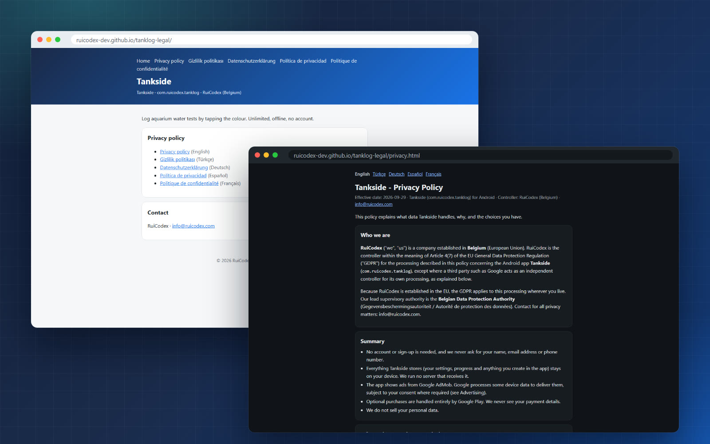
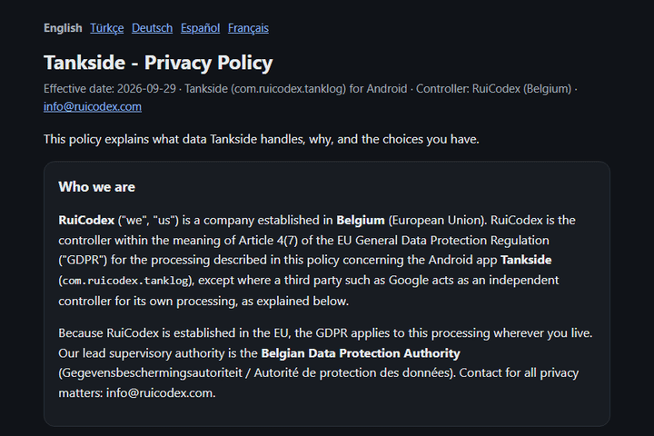
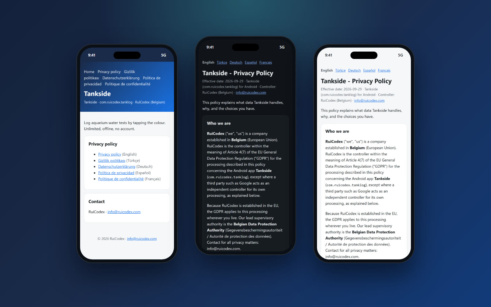
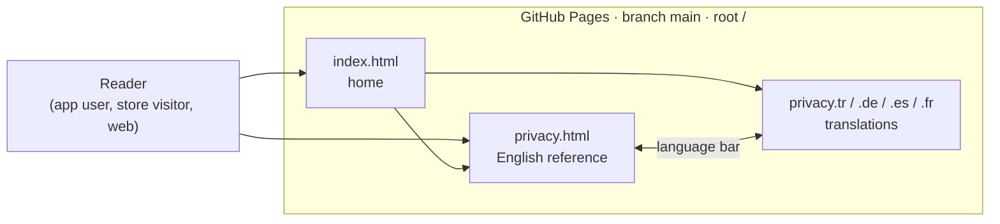

<div align="center">

<picture>
  
</picture>

**The public privacy policy for Tankside, the Android app that logs aquarium water tests by tapping the colour.**


[**Live site**](https://ruicodex-dev.github.io/tanklog-legal/) &nbsp;·&nbsp;
[**Privacy policy**](https://ruicodex-dev.github.io/tanklog-legal/privacy.html) &nbsp;·&nbsp;
[**Pages and languages**](#pages-and-languages) &nbsp;·&nbsp;
[**Edit a policy**](#getting-started) &nbsp;·&nbsp;
[**Rui Codex**](https://ruicodex.com)

</div>

<br>

<p align="center">
  
</p>

## What this is

This repository is the source of the **Tankside legal site**, served by GitHub Pages straight from the `main` branch.
It holds the privacy policy for Tankside (`com.ruicodex.tanklog`), an Android app for logging aquarium water tests:
unlimited, offline and with no account. The policy is written once in English and published in four more languages.
There is no build step, no script and no tracking: six hand-written HTML files with inline CSS that follow the reader's
light or dark system theme.

<table>
<tr>
<td width="33%" valign="top">

**🐠 Device-first, stated plainly**<br>
Your test log, settings and history stay in the app's private storage. No Rui Codex server receives them.

</td>
<td width="33%" valign="top">

**🌍 Five languages**<br>
English, Türkçe, Deutsch, Español and Français, each with a language bar so readers can switch in one tap.

</td>
<td width="33%" valign="top">

**⚖️ Written for the GDPR**<br>
Controller in Belgium, legal bases by article, the Belgian Data Protection Authority, KVKK notes for Türkiye.

</td>
</tr>
<tr>
<td valign="top">

**📣 Ads and consent, explained**<br>
What the Google AdMob SDK collects, and how Google's consent form (UMP) gates personalised ads in the EEA, UK and Switzerland.

</td>
<td valign="top">

**🌗 Light, dark and phone-friendly**<br>
`prefers-color-scheme` swaps the palette, and a 760 px reading column stays comfortable inside an in-app browser.

</td>
<td valign="top">

**🪶 Zero dependencies**<br>
No JavaScript, no external fonts, no cookies, no analytics. `.nojekyll` makes Pages serve the files exactly as written.

</td>
</tr>
</table>

## What the policy says

A short, faithful digest of the English policy (effective **2026-09-29**). The policy itself is the reference; read it in full on the [live site](https://ruicodex-dev.github.io/tanklog-legal/privacy.html).

| Topic | In short |
| --- | --- |
| Account | None. The app never asks for a name, email address or phone number. |
| Your data | Settings, progress, history and anything you enter stay in the app's private storage on your device. No server receives them. |
| Advertising | Ads come from Google AdMob. The SDK sends Google the advertising ID, app set ID, an approximate IP-based location, device and app details and ad interactions. Rui Codex only gets aggregated reports. |
| Consent | In the EEA, the UK and Switzerland, Google's consent form is shown before any ad is requested. Personalised ads need your consent; you can change it under "Privacy options" in the app's settings. |
| Purchases | Optional, and handled by Google Play Billing. Payment details are never seen by Rui Codex; only the product ID and purchase confirmation are kept on the device. |
| Notifications | Reminders are scheduled locally; nothing is sent from a server. |
| Analytics | No analytics or crash-reporting service of our own. |
| Transfers | Google may process data outside the EEA under Standard Contractual Clauses and the EU-U.S. Data Privacy Framework. |
| Children | Intended for users aged 13 and over; ad content is limited to the "G" rating. |
| Deletion | Reset in the app, clear storage in Android Settings, or uninstall. Support emails are kept at most three years. |

## Pages and languages

<p align="center">
  
</p>

| Page | File | Live |
| --- | --- | --- |
| Home (links to every language) | [`index.html`](index.html) | [open](https://ruicodex-dev.github.io/tanklog-legal/) |
| Privacy Policy (English, reference text) | [`privacy.html`](privacy.html) | [open](https://ruicodex-dev.github.io/tanklog-legal/privacy.html) |
| Gizlilik Politikası (Türkçe) | [`privacy.tr.html`](privacy.tr.html) | [open](https://ruicodex-dev.github.io/tanklog-legal/privacy.tr.html) |
| Datenschutzerklärung (Deutsch) | [`privacy.de.html`](privacy.de.html) | [open](https://ruicodex-dev.github.io/tanklog-legal/privacy.de.html) |
| Política de privacidad (Español) | [`privacy.es.html`](privacy.es.html) | [open](https://ruicodex-dev.github.io/tanklog-legal/privacy.es.html) |
| Politique de confidentialité (Français) | [`privacy.fr.html`](privacy.fr.html) | [open](https://ruicodex-dev.github.io/tanklog-legal/privacy.fr.html) |

Each translation carries a note that the English version prevails where the texts differ, unless mandatory law says otherwise.

<p align="center">
  
</p>

## How it works



A push to `main` is all it takes: Pages publishes the repository root as is (`.nojekyll` turns off Jekyll processing).

## Tech stack

| Layer | Choice |
| --- | --- |
| Pages | Hand-written HTML5, one file per page and language |
| Styling | Inline CSS with custom properties, `prefers-color-scheme` dark palette, system font stack |
| Hosting | GitHub Pages from `main`, root folder |
| Tooling | None needed. Any editor and any static file server |

## Getting started

**Preview locally** (any static server works):

```bash
git clone https://github.com/RuiCodex-dev/tanklog-legal.git
cd tanklog-legal
python -m http.server 8000
# open http://localhost:8000/
```

**Change the policy**

1. Edit the English reference, `privacy.html`, and update the effective date in its `.meta` line.
2. Carry the same change into `privacy.tr.html`, `privacy.de.html`, `privacy.es.html` and `privacy.fr.html`, so all five stay in step.
3. Check every page in light and dark mode and at phone width, then commit to `main`. Pages redeploys on its own.

<details>
<summary><b>Adding a language</b></summary>

<br>

1. Copy `privacy.html` to `privacy.<code>.html` (for example `privacy.nl.html`), set `<html lang="<code>">` and translate.
2. Add the translation note (`<p class="note">`) saying the English version prevails.
3. Add the new language to the language bar (`<nav class="langs">`) in **every** privacy page.
4. Add it to the header links and the list in `index.html`, with a matching `hreflang`.

</details>

## Project structure

```text
tanklog-legal/
├── index.html          # home: app summary, links to every language, contact
├── privacy.html        # Privacy Policy (English, reference text)
├── privacy.tr.html     # Gizlilik Politikası
├── privacy.de.html     # Datenschutzerklärung
├── privacy.es.html     # Política de privacidad
├── privacy.fr.html     # Politique de confidentialité
├── .nojekyll           # serve files as is on GitHub Pages
└── docs/media/         # README banner, badges and captures
```

## FAQ

<details>
<summary><b>Which language version is binding?</b></summary>

<br>

The English text. Every translation states that it is provided for convenience and that the English version prevails where they differ, unless mandatory law requires otherwise.

</details>

<details>
<summary><b>How do I turn off personalised ads?</b></summary>

<br>

Use "Privacy options" in the app's settings to change or withdraw your consent at any time. You can also reset or delete your advertising ID in Android Settings > Google > Ads.

</details>

<details>
<summary><b>Does this site track visitors?</b></summary>

<br>

The pages contain no scripts, cookies, external fonts or analytics. Hosting is GitHub Pages; GitHub's own server logging is covered by GitHub's terms.

</details>

<details>
<summary><b>Who do I contact about privacy?</b></summary>

<br>

Rui Codex, Belgium: info@ruicodex.com, with "Privacy - Tankside" in the subject line. You can also complain to the Belgian Data Protection Authority or the authority where you live, as the policy explains.

</details>

---

<div align="center">

**All rights reserved, © 2026 Rui Codex.** The policy texts may not be reused for other products without permission.

Built by **[Rui Codex](https://ruicodex.com)** · Contact: info@ruicodex.com

<sub>Media credits: all screenshots and the language GIF are real captures of the live site; the banner (an illustrated pH colour chart, not app UI) and the badges are hand-built SVG. No generated imagery, narration or music is used in this README.</sub>

</div>
